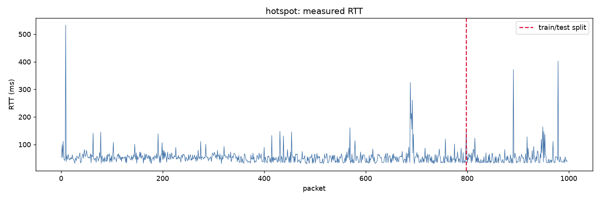
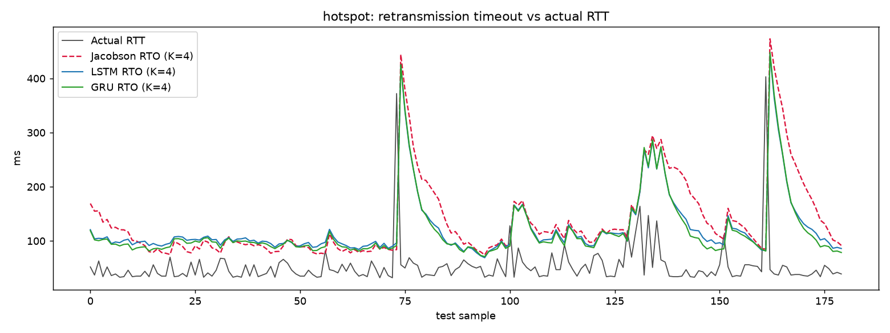
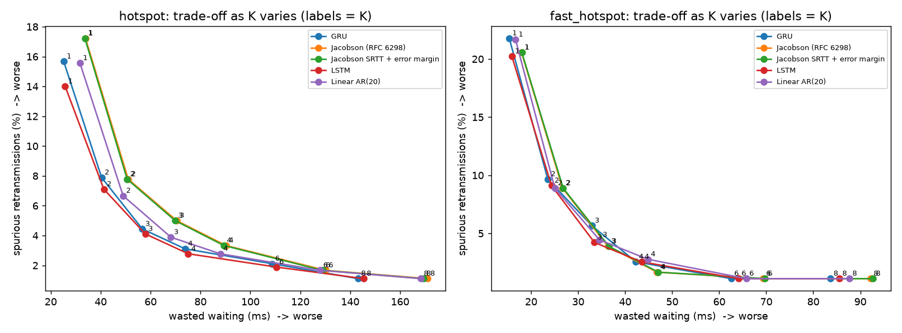

# Adaptive TCP Retransmission Timeout Estimation with LSTM and GRU

**Computer Networks — Project #10**  
**Team:** Vihan Bhatt · Shubhang · Vihaan Dhole

This repository evaluates whether time-series models can estimate network **round-trip time (RTT)** more accurately than conventional TCP smoothing, and whether those estimates yield useful **retransmission timeout (RTO)** decisions. It contains the experimental Python implementation, two supplied ping-derived RTT datasets, archived metrics, and figures.

> [!IMPORTANT]
> **Scope of this implementation:** the code trains **LSTM** and **GRU** networks and a **linear AR(20)** benchmark. It also evaluates **Jacobson (RFC 6298 formula, with the 1-second floor disabled)** and **Jacobson SRTT with the same error-margin rule as the models**. It does **not** train a Transformer or apply Karn backoff in its main evaluation. It is an **offline RTT/RTO simulation using ping data**, not a modified TCP stack or a live network throughput test.

## Why this project?

TCP retransmits unacknowledged segments after a timer expires. An RTO that is **too short** can cause an unnecessary retransmission; an RTO that is **too long** delays recovery after genuine loss. Standard RTT smoothing trades responsiveness for stability. Here we compare its one-step-ahead RTT estimates with sequence models and derive timeouts from those estimates.

## How it works

```text
Supplied ping-derived RTT CSV files (milliseconds)
                  |
                  v
   80/20 chronological train/test split
                  |
                  v
   Scale RTTs using the training set only
                  |
                  v
      Windows of 20 previous RTT values
                  |
                  v
    Predict next RTT with LSTM / GRU / AR(20)
      Also calculate Jacobson SRTT baseline
                  |
                  v
    RTO = predicted RTT + K × EWMA(past |error|)
                  |
                  v
  Evaluate prediction MAE/RMSE, timeout proxy,
          and wasted-wait proxy
                  |
                  v
   Compare K = 1, 2, 3, 4, 6, 8; bootstrap CI
```

**Important:** the standalone Jacobson baseline instead uses `SRTT + max(G, K × RTTVAR)`, not the model's error-margin formula. The "Jacobson SRTT + error margin" comparator isolates this difference.

## Repository structure

```text
tcp-rto-deep-learning/
├── README.md
├── LICENSE
├── .gitignore
├── .gitattributes
├── requirements.txt
├── requirements-nn.txt
├── jacobson.py                 # Jacobson RTT/RTO estimator, optional Karn helper
├── run_experiment.py           # Main CLI for models, metrics and plots
├── data/
│   ├── README.md
│   ├── hotspot.csv
│   └── fast_hotspot.csv
├── results/
│   ├── README.md
│   ├── metrics/
│   │   ├── all_runs.csv
│   │   ├── results_k4.csv
│   │   ├── ksweep.csv
│   │   └── bootstrap.csv
│   └── figures/
│       ├── hotspot_fig1_raw.png
│       ├── hotspot_fig2_prediction.png
│       ├── hotspot_fig3_rto.png
│       ├── fast_hotspot_fig1_raw.png
│       ├── fast_hotspot_fig2_prediction.png
│       ├── fast_hotspot_fig3_rto.png
│       └── fig4_ksweep_tradeoff.png
├── docs/
│   ├── METHODOLOGY.md
│   ├── RESULTS_AND_LIMITATIONS.md
│   └── PRESENTATION_GUIDE.md
├── scripts/
│   └── validate_saved_results.py
├── tests/
│   ├── test_jacobson.py
│   └── test_experiment.py
└── .github/workflows/ci.yml
```

## Quick start

Use a Python environment compatible with your OS and package versions. Run the commands **from the project root**.

```bash
python -m venv .venv
```

Activate it on **Windows (PowerShell)**:

```powershell
.venv\Scripts\Activate.ps1
```

Or on **macOS / Linux**:

```bash
source .venv/bin/activate
```

For the full neural-network experiment:

```bash
python -m pip install -r requirements-nn.txt
python run_experiment.py --hotspot data/hotspot.csv --fast data/fast_hotspot.csv
```

The experiment trains 5 seeds (`42`–`46`) per LSTM/GRU model **for each dataset**. It can take longer on a CPU. The output goes to the ignored `outputs/` folder by default; the uploaded reference results are preserved in `results/`.

To run **only the classical/linear baselines**, without TensorFlow:

```bash
python -m pip install -r requirements.txt
python run_experiment.py --hotspot data/hotspot.csv --fast data/fast_hotspot.csv --no-nn
```

If TensorFlow is not installed and you omit `--no-nn`, the script will automatically run without LSTM/GRU and print a message. It **will not reproduce the archived neural results** unless TensorFlow is available.

Available arguments:

| Flag | Default | Purpose |
| --- | --- | --- |
| `--hotspot` | `hotspot.csv` | Path to first dataset |
| `--fast` | `fast_hotspot.csv` | Path to second dataset |
| `--outdir` | `outputs` | Destination for newly computed CSVs and PNGs |
| `--no-nn` | off | Skip TensorFlow models |

Pass the dataset paths as shown in the examples above. The two path defaults are retained for compatibility with the original script.

## Data

| Dataset | Total measurements | Training measurements | Held-out measurements | Evaluated test targets |
| --- | ---: | ---: | ---: | ---: |
| `hotspot.csv` | 998 | 798 | 200 | 180 |
| `fast_hotspot.csv` | 1,000 | 800 | 200 | 180 |

Both files have `seq` (sequential sample identifier) and `rtt_ms` (measured RTT in milliseconds). A 20-point window is formed **inside** the test partition, so its first 20 rows are history, leaving 180 evaluated targets per session. Only the processed CSVs were supplied; the original ping command logs and the full data-collection scripts are **not** part of this repository.

## Reference results (K = 4)

Values below are the **uploaded archived results**, not newly retrained neural models. LSTM/GRU numbers are means over five seeds. Values are rounded from `results/metrics/results_k4.csv`.

| Session | Estimator | RTT MAE (ms) ↓ | Timeout proxy (%) ↓ | Wasted wait proxy (ms) ↓ |
| --- | --- | ---: | ---: | ---: |
| Hotspot | Jacobson | 20.314 | 3.333 | 90.183 |
| Hotspot | Linear AR(20) | 20.323 | 2.778 | 87.939 |
| Hotspot | LSTM | 17.732 | 2.778 | 75.102 |
| Hotspot | GRU | **17.552** | 3.111 | **73.807** |
| Fast hotspot | Jacobson | 11.666 | **1.667** | 46.779 |
| Fast hotspot | Linear AR(20) | 11.136 | 2.778 | 44.813 |
| Fast hotspot | LSTM | 10.828 | 2.556 | 43.475 |
| Fast hotspot | GRU | **10.644** | 2.556 | **42.270** |

These are **offline proxies**, not a count of real TCP retransmission events. For this evaluation:

- **MAE** = average `|actual RTT − predicted RTT|`.
- **Timeout proxy (%)** = percentage of samples with `RTO < actual RTT`; it is labeled `spurious_pct` in the CSV.
- **Wasted wait proxy (ms)** = average `RTO − RTT` **only for samples where `RTO ≥ RTT`**, not the average over all samples.
- **K** is the safety factor; increasing K generally reduces early timeout predictions while increasing surplus waiting.

The two Jacobson variants and their complete metrics, standard deviations, K sweeps, and bootstrap intervals are included in `results/metrics/`.

### Sample visualizations

**Network RTT measurements and chronological split:**



**Comparing timeout estimates on the hotspot test set:**



**Trade-off as the safety margin K changes:**



See [Results and limitations](docs/RESULTS_AND_LIMITATIONS.md) for interpretation and caveats.

## Validate and test

```bash
python -m unittest discover -s tests -v
python scripts/validate_saved_results.py
```

The tests run without TensorFlow. The validation script checks saved CSV consistency and the presence of the seven reference figures. A baseline-only independent run was also checked against the uploaded summary: all baseline K=4 metrics matched at their stored precision.

## Technical and reporting limitations

1. **Not a deployed TCP stack:** no actual packet retransmission or throughput was measured. Data are ICMP-ping RTTs.
2. **Not a full RFC 6298 implementation:** the 1-second RTO floor is intentionally disabled in `jacobson.py` for millisecond-scale comparison.
3. **Karn is not a main evaluated method:** `jacobson.py` contains a `karn_backoff()` helper, but the main code does not use it or exclude retransmission-ambiguous RTT samples.
4. **No Transformer in the uploaded code/results:** documents claiming a trained Transformer should be reconciled with the actual implementation.
5. **Neural training was not rerun during repository assembly:** TensorFlow was not installed in the packaging environment. Supplied neural metrics and figures are archived unchanged; the code's non-neural baselines were verified.
6. **Scope of the sample:** only two RTT traces, one network target as described in the associated assignment, and 180 evaluated test targets per dataset.
7. **Saved seed metadata:** the original `all_runs.csv` stored neural seed positions `0`–`4` rather than actual random seeds `42`–`46`. This repository corrects that **metadata column only** to match `run_experiment.py`; the numerical metrics are unchanged.

## License

MIT (see [LICENSE](LICENSE)). The copyright holder is recorded as Project Team 10; edit this if a different attribution/license is required by your course or collaborators.
